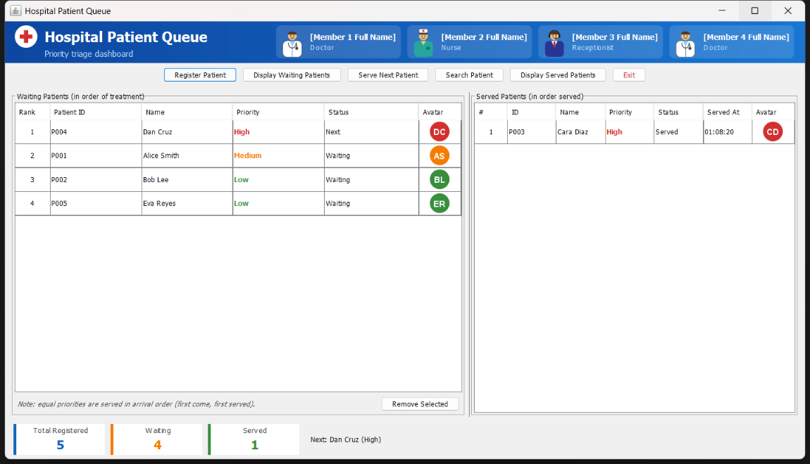
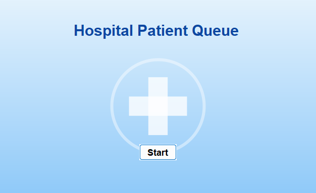

# Hospital Patient Queue

A desktop app that manages a hospital waiting room as a **priority queue**. Patients are registered with a triage priority (High, Medium or Low). The app always serves the most urgent patient next, and patients with equal priority are served in the order they arrived.

Built with **Java Swing**, using only the standard JDK. No external libraries.



## Features

- **Welcome screen**: a hospital-themed opening screen drawn with `Graphics2D`. Click **Start** to open the dashboard.
- **Register Patient**: enter a patient ID, full name and priority. The form checks that:
  - every field is filled in (spaces alone don't count);
  - the ID isn't already used by a waiting or served patient, ignoring case.

  If something is wrong, it lists every problem and keeps what you typed.
- **Waiting table**: columns are Rank, Patient ID, Name, Priority, Status and Avatar. **Rank 1** is the next patient to be served.
- **Serve Next Patient**: takes the next patient off the queue and marks them **Served**. The patient visibly moves from the waiting panel to the served panel over about one second.
- **Search Patient**: matches an exact ID or part of a name, ignoring case, in both waiting and served patients. Each match shows its rank (if waiting), priority and status. If nothing matches, it shows **Not found**.
- **Display Served Patients**: patients in the order they were served, with the time each one was served.
- **Statistics**: Total Registered, Waiting and Served. Total always equals Waiting + Served, and the numbers update after every action.
- **Empty-queue handling**: placeholders in the empty tables, statistics at 0, and Serve Next shows "No patients are waiting" instead of failing.
- **Team header**: each group member appears as a doctor, nurse or receptionist character with their name.
- **Exit** asks for confirmation, and so does closing the window.

<p align="center"></p>

## How the queue decides who is next

Patients are stored in a `java.util.PriorityQueue<Patient>` ordered by this comparator:

```java
Comparator.comparingInt((Patient p) -> p.getPriority().getRank())   // High=1, Medium=2, Low=3
          .thenComparingLong(Patient::getArrivalOrder);             // tie-break: earlier arrival first
```

| Priority | Rank | Color  |
|----------|------|--------|
| High     | 1    | Red    |
| Medium   | 2    | Orange |
| Low      | 3    | Green  |

- **Lower rank is served first.**
- **Ties are broken by `arrivalOrder`**, a number that goes up with every registration. Among patients with the same priority, the one who arrived first is served first.
- **Serving uses `poll()`**, which always removes the head of the queue.
- **The table uses a sorted copy.** A `PriorityQueue`'s iterator does *not* return elements in priority order, so the waiting table is never built by looping over the queue. `PatientQueue.inOrder()` copies the patients into a list and sorts it with the same comparator.

**Example:** register A (High), B (Low), C (Medium), D (High) and E (Low), in that order. They are served **A, D, C, B, E**.

## Requirements

- **JDK 17 or newer.** The code uses records, switch expressions and `instanceof` pattern matching.

## How to run

From the project folder:

```bash
javac -d out src/hospital/*.java
java -cp out hospital.Main
```

## How to run the tests

The tests are a plain `main` method, so JUnit isn't needed. Each check prints `PASS` or `FAIL`, and the program exits with code 1 if anything fails.

```bash
javac -d out src/hospital/*.java test/hospital/*.java
java -cp out hospital.PatientQueueTest
```

They cover:
- the serve order for A, B, C, D, E;
- that the ranking matches the serve order;
- rejection of duplicate IDs and blank fields;
- that serving from an empty queue is safe;
- zero statistics for an empty queue.

## Project structure

```
HospitalPatientQueue/
├── src/hospital/
│   ├── Main.java              Entry point: opens the welcome screen
│   ├── WelcomeFrame.java      Opening screen with the Start button
│   ├── QueueFrame.java        Dashboard: buttons, tables, animation, dialogs
│   ├── StaffPanel.java        Header with the app title and team member badges
│   ├── StatisticsPanel.java   Total Registered / Waiting / Served tiles
│   ├── PatientQueue.java      Priority queue, served history, search, validation
│   ├── Patient.java           id, name, priority, arrivalOrder, status
│   ├── Priority.java          HIGH / MEDIUM / LOW with rank, label and color
│   └── PatientAvatar.java     Initials avatar colored by priority
├── test/hospital/
│   └── PatientQueueTest.java  Tests (main method, no JUnit)
└── docs/                      Screenshots used in this README
```

## Adding your group members

Open `src/hospital/StaffPanel.java` and edit the `GROUP_MEMBERS` list. Replace each placeholder with a full name and choose `DOCTOR`, `NURSE` or `RECEPTIONIST`:

```java
public static final List<Member> GROUP_MEMBERS = List.of(
        new Member("[Member 1 Full Name]", Role.DOCTOR),
        new Member("[Member 2 Full Name]", Role.NURSE),
        new Member("[Member 3 Full Name]", Role.RECEPTIONIST),
        new Member("[Member 4 Full Name]", Role.DOCTOR)
);
```

Add or remove lines to match the size of your group.
